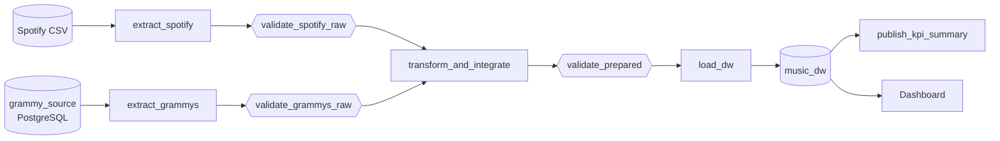
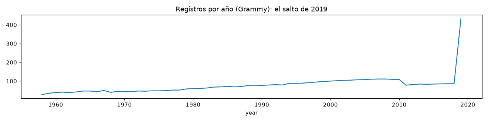
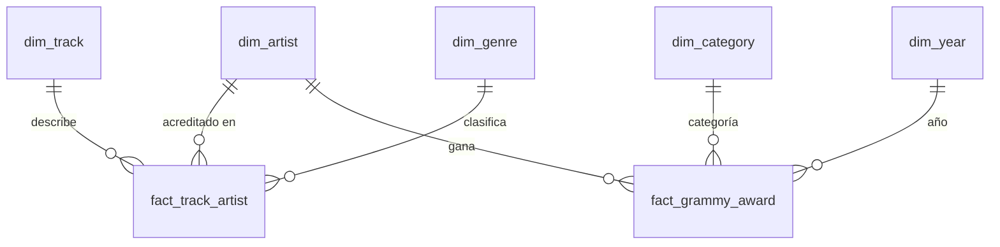

# ETL Workshop-2 — Pipeline batch confiable: Spotify + Premios Grammy

**Curso:** ETL (G01) — Ingeniería de Datos e Inteligencia Artificial, Universidad Autónoma de Occidente
**Autora:** Nikol Hurtado

Pipeline batch que integra datos de Spotify (CSV) y de los Premios Grammy (base de datos
PostgreSQL de origen), los valida con **Great Expectations 1.23.1** en dos compuertas, los orquesta
con **Apache Airflow 3.1.8** (TaskFlow API) y los carga en un **Data Warehouse dimensional** en
PostgreSQL que alimenta KPIs y un dashboard.

> **Principio:** el pipeline no asume que los datos son correctos; lo verifica. Y no asume que la
> ejecución saldrá bien: las fallas están anticipadas, controladas y son observables.

---

## Tabla de contenido

1. [Problema y objetivo analítico](#1-problema-y-objetivo-analítico)
2. [Requerimientos analíticos](#2-requerimientos-analíticos)
3. [Fuentes de datos](#3-fuentes-de-datos)
4. [Arquitectura del pipeline](#4-arquitectura-del-pipeline)
5. [Hallazgos del perfilado](#5-hallazgos-del-perfilado)
6. [Riesgos y reglas de calidad](#6-riesgos-y-reglas-de-calidad)
7. [Diseño de validación con Great Expectations](#7-diseño-de-validación-con-great-expectations)
8. [Estrategia de transformación e integración](#8-estrategia-de-transformación-e-integración)
9. [Modelo dimensional](#9-modelo-dimensional)
10. [Diseño del DAG de Airflow](#10-diseño-del-dag-de-airflow)
11. [Política de fallas y reintentos](#11-política-de-fallas-y-reintentos)
12. [Evidencia de ejecución exitosa](#12-evidencia-de-ejecución-exitosa)
13. [Evidencia de falla controlada](#13-evidencia-de-falla-controlada)
14. [Estrategia de repetibilidad](#14-estrategia-de-repetibilidad)
15. [Dashboard y salidas analíticas](#15-dashboard-y-salidas-analíticas)
16. [Instalación y ejecución](#16-instalación-y-ejecución)
17. [Supuestos, decisiones y limitaciones](#17-supuestos-decisiones-y-limitaciones)
18. [Registro de evidencias](#18-registro-de-evidencias)
19. [Matriz de trazabilidad](#19-matriz-de-trazabilidad-de-extremo-a-extremo)

---

## 1. Problema y objetivo analítico

¿El reconocimiento de la industria musical se traduce en audiencia? El producto de datos relaciona
los **premios Grammy ganados (1958–2018)** con el **desempeño actual y el perfil sonoro** de los
artistas en Spotify. Ninguna fuente por sí sola responde la pregunta: Spotify no sabe quién fue
premiado y Grammy no sabe qué tan escuchado es hoy un artista ni cómo suena su música.

**Alcance:** integración a nivel de **artista** (nombre normalizado), porque es el único atributo
común. Detalle completo en [`docs/requirements.md`](docs/requirements.md).

## 2. Requerimientos analíticos

| ID | Pregunta | KPI(s) | Nivel de detalle |
| --- | --- | --- | --- |
| **R1** | ¿Los artistas ganadores del Grammy tienen mayor popularidad actual en Spotify que los que no han ganado? | KPI-1 popularidad promedio ganadores vs. no ganadores · KPI-2 % de artistas con Grammy | Artista |
| **R2** | ¿Qué géneros de Spotify concentran a los artistas ganadores? | KPI-3 % de artistas ganadores por género · KPI-4 premios por género | Género × artista |
| **R3** | ¿En qué se diferencia el perfil sonoro de las canciones de artistas ganadores? | KPI-5 promedio de características de audio por grupo | Canción |
| **R4** | ¿Los premiados más recientemente conservan hoy más popularidad? | KPI-6 popularidad por década del último premio · KPI-7 artistas por década | Artista × década |

Los IDs R1–R4 se usan en todo el repositorio (reglas, expectations, transformaciones, vistas KPI).

## 3. Fuentes de datos

| Fuente | Forma entregada | Fuente de extracción del pipeline | Ubicación |
| --- | --- | --- | --- |
| Spotify | CSV (114,000 filas, 21 columnas) | Archivo CSV | `data/raw/spotify_dataset.csv` |
| Premios Grammy | CSV (4,810 filas, 10 columnas) | **Base de datos PostgreSQL** `grammy_source.grammy_awards` | Original: `data/raw/the_grammy_awards.csv` |

Los originales se conservan sin modificar; PostgreSQL y Airflow los montan en **solo lectura**.

### Preparación de la fuente Grammy (no es la Carga final del ETL)

`sql/source_setup.sql` crea la base operativa `grammy_source` y carga el CSV en `grammy_awards`
**sin limpiar nada**, para que la validación raw detecte los problemas reales. Agrega una llave
técnica `id` (el CSV no trae identificador), es re-ejecutable (borra y recarga) y se detiene ante el
primer error (`ON_ERROR_STOP`).

| Conciliación de filas | Valor |
| --- | --- |
| Registros en el CSV (sin encabezado) | 4,810 (4,811 líneas físicas: no hay saltos de línea dentro de los campos) |
| Filas en `grammy_awards` tras la carga | 4,810 ✅ |
| Filas tras re-ejecutar el script | 4,810 ✅ (no duplica) |

La tarea `extract_grammys` lee **desde esta base de datos**, nunca desde el CSV (ver
`src/extract.py` y el log de la tarea, que muestra `source: postgresql://postgres/grammy_source.grammy_awards`).

## 4. Arquitectura del pipeline



| Diseño de calidad alrededor del flujo | Controles de confiabilidad |
| --- | --- |
| Perfilado → riesgos P01–P17 → reglas DQ01–DQ22 → 5 Expectation Suites → 2 compuertas | Dependencias · reintentos selectivos · logs por regla · resultados GX en JSON · falla controlada · rerun idempotente |

La lógica vive en `src/` (`extract.py`, `validation.py`, `transform.py`, `load.py`); el DAG solo
orquesta. Detalle: [`docs/architecture.md`](docs/architecture.md).

## 5. Hallazgos del perfilado

Notebook reproducible: [`notebooks/data_profiling.ipynb`](notebooks/data_profiling.ipynb). No modifica
datos; guarda tablas de evidencia en [`docs/evidence/profiling/`](docs/evidence/profiling/).

| Hallazgo | Evidencia | Consecuencia |
| --- | --- | --- |
| 🔴 **El lote 2019 de Grammy mezcla nominados con ganadores** | 1958–2018: ~1 registro por (año, categoría), máximo 2 (empates). 2019: 433 registros, 84 categorías con 5–8 "ganadores", todos `winner = True` | Cuarentena del lote (T09); análisis de ganadores 1958–2018 |
| `artist` vacío en 38 % de Grammy | Concentrado en categorías de obra o persona; en *New Artist* el artista está en `nominee` | T10 / T11; baja cobertura esperada |
| `track_id` no es único en Spotify | 89,741 ids en 114,000 filas: la granularidad es canción × género | El grano del hecho incluye el género |
| 450 duplicados exactos y 720 canciones con dos popularidades | Tabla `03_unicidad.csv` | T03 y T04 |
| Valores imposibles | `tempo = 0` (157), `time_signature = 0` (163) | T05 → nulo |
| Nulos disfrazados | Créditos `N/A`, `Unknown`, `Various Artists` | T06 los descarta |
| Cruce por nombre | 26.5 % sin normalizar → 29.7 % normalizado → 34.7 % con artista principal (filas Grammy) | Contrato de integración en 2 pasos |
| `year` limpio | 1958–2019 sin vacíos y coincide con `title` | Se vigila con DQ10 |



## 6. Riesgos y reglas de calidad

22 reglas: 13 raw y 9 preparadas, con métrica, umbral, severidad y justificación de cada umbral.
Tabla completa en [`docs/quality_rules.md`](docs/quality_rules.md). Resumen:

| Severidad | Reglas | Respuesta |
| --- | --- | --- |
| Critical | DQ01–DQ06, DQ09–DQ11 (raw) · DQ14–DQ20 (preparadas) | Falla la compuerta y se bloquea lo posterior |
| Warning | DQ07, DQ08, DQ12, DQ13 (raw) · DQ21 (integración) | Se registra y continúa según la política |
| Info | DQ22 | Solo monitoreo |

## 7. Diseño de validación con Great Expectations

| Elemento | Implementación |
| --- | --- |
| Data object | DataFrame del lote raw o preparado de cada ejecución (`data/work/<run_id>/`) |
| Expectation Suites | `spotify_raw_suite`, `grammy_raw_suite`, `prepared_fact_track_artist_suite`, `prepared_fact_grammy_award_suite`, `prepared_dim_artist_suite` (exportadas en `gx/expectations/`) |
| Validation Definition | `<suite>_validation`: batch definition del DataFrame + suite |
| Ejecución y política | `run_suite()` → `get_max_severity_failure()` → `enforce_policy()`: Critical lanza excepción (la tarea falla), Warning/Info se registran |
| Resultados | `gx/validation_results/<run_id>/<suite>.json`: éxito, estadísticas, **resumen por regla** (rule_id, severidad, % inesperado, valor observado) y el resultado completo de GX |

Cada Expectation lleva `meta.rule_id`; el mapeo Expectation → regla está en
[`docs/quality_rules.md`](docs/quality_rules.md#mapeo-expectation--rule-id). Resultado con los datos
entregados: Spotify ✅, Grammy ⚠️ Warning DQ13 (lote 2019), suites preparadas ✅.

## 8. Estrategia de transformación e integración

Una sola fase (`transform_and_integrate`) con 13 reglas T01–T13, cada una con evidencia, campos
afectados, comportamiento antes/después, manejo de excepciones e impacto analítico. Registro
completo en [`docs/transformation_decisions.md`](docs/transformation_decisions.md).

**Contrato de integración:** llave = nombre de artista normalizado. Emparejamiento en 2 pasos (nombre
completo y, si no existe en Spotify, artista principal). Cardinalidad muchos a uno hacia `dim_artist`.
Los registros sin coincidencia se conservan y se miden (`matched_spotify`, DQ21).

| Resultado (lote entregado) | Valor |
| --- | --- |
| Premios con artista (1958–2018) | 2,771 |
| Encontrados en Spotify | 1,472 (53.1 %): 1,234 por nombre completo + 238 por artista principal |
| Ganadores distintos encontrados en Spotify | 549 de 1,348 |
| Filas en cuarentena (lote 2019) | 433 → `prepared/grammy_quarantine.csv` |

Cada ejecución deja `data/work/<run_id>/prepared/integration_report.json` con las filas afectadas
por cada regla.

## 9. Modelo dimensional

Dos esquemas estrella que comparten la **dimensión conformada `dim_artist`**. Detalle y diagrama
en [`docs/dimensional_model.md`](docs/dimensional_model.md); DDL ejecutable en
[`sql/dw_schema.sql`](sql/dw_schema.sql).

| Hecho | Grano | Medidas |
| --- | --- | --- |
| `fact_track_artist` | Una canción × un artista acreditado × un género | popularity, características de audio, tempo, loudness |
| `fact_grammy_award` | Un premio ganado por un artista en una categoría y un año | award_count, matched_spotify |

Dimensiones: `dim_artist` (conformada), `dim_track`, `dim_genre`, `dim_category`, `dim_year`.
Llaves subrogadas deterministas, llaves de negocio `UNIQUE`, todas las FK declaradas.



## 10. Diseño del DAG de Airflow

`dags/reliable_music_pipeline.py` — `dag_id = reliable_music_pipeline`, TaskFlow API
(`from airflow.sdk import dag, task`), `schedule=None` (ejecución manual inspeccionable),
`max_active_runs=1` y parámetro `spotify_file` para elegir el lote.

- Ramas independientes y observables: `extract_spotify → validate_spotify_raw` y
  `extract_grammys → validate_grammys_raw`.
- `[validate_spotify_raw, validate_grammys_raw] >> transform_and_integrate`: no se transforma
  hasta que **ambas** compuertas cumplan la política.
- `validate_prepared >> load_dw`: no se carga sin la compuerta preparada.
- Las tareas intercambian **rutas y metadatos compactos** (XCom), nunca DataFrames.

## 11. Política de fallas y reintentos

| Clase de tarea | Reintentos | Por qué |
| --- | --- | --- |
| Archivos, validaciones, transformación | **0** | Sus fallas son deterministas: el mismo input falla igual |
| `extract_grammys`, `load_dw`, `publish_kpi_summary` | **3, con espera exponencial** (30 s → 60 s → 120 s) | Tocan PostgreSQL: una caída o corte de red puede resolverse solo |

Además, en las tareas de base de datos **solo se reintentan las fallas transitorias**
(`OperationalError`/`InterfaceError`). Un error de datos (tipo inválido, llave foránea, tabla
inexistente) lanza `AirflowFailException` y falla sin consumir reintentos (`src/db.is_transient()`).
Tabla completa de condiciones y respuestas en [`docs/architecture.md`](docs/architecture.md#política-de-fallas).

## 12. Evidencia de ejecución exitosa

**Prueba A:** *Trigger DAG* con los parámetros por defecto.

| Etapa | Resultado esperado |
| --- | --- |
| Extracción | Spotify 114,000 filas · Grammy 4,810 filas desde PostgreSQL |
| Compuertas raw | Spotify ✅ · Grammy ✅ con Warning DQ13 |
| Transformación | Reporte de integración (sección 8) |
| Compuerta preparada | ✅ las 3 suites |
| Carga | `fact_track_artist` 156,739 · `fact_grammy_award` 2,771 · `dim_artist` 30,249 |
| Analítica | `kpi_summary.json` con las 4 vistas KPI |

🚧 *Pantallazos de la ejecución en el entorno Docker: ver registro de evidencias (E03–E05).*

## 13. Evidencia de falla controlada

**Prueba B:** se viola la regla Critical **DQ04** (`popularity` entre 0 y 100) **sin tocar el
archivo original**. Se crea una copia con una sola fila en `popularity = 150`:

```powershell
docker compose exec airflow-scheduler python /opt/airflow/src/make_bad_data.py
```

Luego, en Airflow: **Trigger DAG → con configuración** → `spotify_file = spotify_bad_popularity.csv`.

| Etapa | Resultado esperado |
| --- | --- |
| `extract_spotify` | ✅ success |
| `validate_spotify_raw` | ❌ failed: `Validacion con severidad CRITICAL. Reglas violadas: ['DQ04']` |
| `transform_and_integrate`, `validate_prepared`, `load_dw`, `publish_kpi_summary` | `upstream_failed` (no se ejecutan) |
| Data Warehouse | Sin cambios (misma carga anterior) |

**Por qué se bloquea:** una popularidad fuera del contrato de Spotify corrompería KPI-1 y KPI-6. GX
detecta la violación, la política la clasifica como Critical y Airflow impide que se ejecute lo posterior.

🚧 *Pantallazos de Grid view, log y JSON de GX: ver E06–E08.*

## 14. Estrategia de repetibilidad

**Truncate-and-load transaccional:** dentro de una transacción se trunca y recarga el modelo, se
concilian los conteos con los archivos preparados y se registra la carga en `etl_load_audit`. Luego
`COMMIT`. Si algo falla, `ROLLBACK` y el DW queda como estaba.

**Prueba C:** ejecutar el DAG dos veces con el mismo lote y comparar:

```powershell
docker compose exec postgres sh -c 'psql -U "$POSTGRES_USER" -d music_dw -f /sql/rerun_check.sql'
```

| Medida | 1ª carga | 2ª carga |
| --- | --- | --- |
| `fact_track_artist` | 156,739 | 156,739 |
| `fact_grammy_award` | 2,771 | 2,771 |
| `SUM(popularity)` | 5,251,467 | 5,251,467 |
| Hash de llaves de `dim_artist` | `c5a726b4…` | `c5a726b4…` |
| Filas en `etl_load_audit` | 1 | 2 |

*(Valores de la verificación en el entorno de desarrollo; se repiten con los pantallazos E09.)*

## 15. Dashboard y salidas analíticas

Las 4 vistas KPI viven **en el DW** (`sql/dw_schema.sql`). El dashboard consulta esas vistas o las
tablas del modelo, nunca los CSV.

| Requerimiento | Elemento del DW / consulta | KPI / visualización | Resultado (lote entregado) |
| --- | --- | --- | --- |
| R1 | `kpi_r1_popularity_by_winner` | Tarjetas KPI-1 y KPI-2 + barras ganador vs. no ganador | Popularidad 35.51 (ganadores) vs. 35.38 (resto): **sin diferencia relevante**. 1.86 % de los artistas tiene Grammy |
| R2 | `kpi_r2_genre_winners` | Barras: % de artistas ganadores por género | Rock (26.5 %), country (21.9 %), honky-tonk, soul y jazz encabezan |
| R3 | `kpi_r3_audio_profile` | Barras agrupadas por característica | Las canciones de ganadores son **más acústicas (0.40 vs 0.32), menos enérgicas (0.56 vs 0.64) y menos instrumentales** |
| R4 | `kpi_r4_popularity_by_decade` | Línea: popularidad por década del último premio | Crece de 6.6 (1950s) a 36.0 (2010s): los premiados recientes conservan más audiencia |

🚧 *Dashboard en Power BI conectado a `music_dw` (localhost:5432): pendiente.*

## 16. Instalación y ejecución

### Requisitos

| Herramienta | Versión usada |
| --- | --- |
| Docker Desktop (backend WSL2) | Docker 29.4.0 · Compose v5.1.2 |
| Git | — |
| Memoria RAM | 8 GB recomendado (probado con 7.2 GB; cada tarea usa ~300 MB) |

### Pasos

```powershell
# 1. Clonar (ruta sin espacios y fuera de OneDrive)
git clone https://github.com/nikolalehurtado/ETL-Workshop-2.git
cd ETL-Workshop-2

# 2. Secretos: copiar la plantilla y reemplazar los valores
#    (las contraseñas no deben contener @ : /)
Copy-Item .env.example .env

# 3. Construir la imagen (Airflow 3.1.8 + Great Expectations 1.23.1) e inicializar Airflow
docker compose build
docker compose up airflow-init          # debe terminar con "exited with code 0"

# 4. Encender los servicios y verificar que estén (healthy)
docker compose up -d
docker compose ps
docker compose exec airflow-scheduler airflow version     # 3.1.8

# 5. Preparar la fuente Grammy (una vez)
docker compose exec postgres sh -c 'psql -U "$POSTGRES_USER" -d postgres -f /sql/source_setup.sql'
```

6. Abrir **http://localhost:8080** (usuario y contraseña de `.env`), activar el DAG
   **`reliable_music_pipeline`** y ejecutar **Trigger**. La base `music_dw` se crea sola en la primera carga.

**Conexión para BI / notebooks:** host `localhost`, puerto `5432`, base `music_dw`, usuario y
contraseña de `.env`.

```powershell
docker compose down      # apaga y conserva los datos
docker compose down -v   # apaga y BORRA las bases de datos (reinicio desde cero)
```

### Estructura del repositorio

```
ETL-Workshop-2/
├── dags/reliable_music_pipeline.py   # DAG (solo orquestación)
├── src/
│   ├── config.py        # rutas, conexiones y contratos de columnas
│   ├── extract.py       # extracción sin limpieza
│   ├── validation.py    # suites GX, ejecución y política de severidad
│   ├── transform.py     # T01–T13 e integración
│   ├── load.py          # carga transaccional al DW
│   ├── db.py · files.py # conexiones y lectura uniforme de CSV
│   └── make_bad_data.py # lote de la Prueba B
├── sql/
│   ├── source_setup.sql # preparación de la fuente Grammy
│   ├── dw_schema.sql    # esquema estrella + vistas KPI
│   └── rerun_check.sql  # evidencia de rerun seguro
├── gx/expectations/     # suites exportadas (resultados en gx/validation_results/, no versionados)
├── notebooks/data_profiling.ipynb
├── docs/                # requerimientos, reglas, transformaciones, modelo, arquitectura, evidencias
├── data/raw/            # originales (solo lectura); data/work/ y data/test/ se generan
├── Dockerfile · requirements.txt · docker-compose.yaml
└── .env.example         # plantilla sin credenciales reales
```

## 17. Supuestos, decisiones y limitaciones

### Decisiones de entorno

El `docker-compose.yaml` parte del archivo oficial de Apache Airflow 3.1.8, adaptado para un equipo
local con recursos limitados:

| Decisión | Original oficial | Adaptación | Justificación |
| --- | --- | --- | --- |
| Executor | CeleryExecutor | **LocalExecutor** | Celery distribuye tareas entre varias máquinas; con un solo equipo, LocalExecutor ejecuta las tareas en el scheduler y elimina contenedores innecesarios |
| Redis, worker y Flower | Incluidos | **Eliminados** | Solo los usa CeleryExecutor |
| Triggerer | Incluido | **Eliminado** | Solo ejecuta tareas diferibles; el DAG es batch con tareas TaskFlow normales. Por eso la interfaz muestra "Triggerer" en rojo: es el resultado esperado, no una falla |
| Imagen | `apache/airflow:3.1.8` | **Imagen propia** con `great_expectations==1.23.1` (Dockerfile) | Dependencias fijadas en la imagen y no instaladas en cada arranque: entorno reproducible |
| DAGs de ejemplo | Activados | **Desactivados** | Menos memoria y menos ruido |
| Credenciales | Escritas en el archivo | **Leídas de `.env`** | Los secretos no se suben; si falta una variable Docker se detiene con un mensaje explícito |
| Healthcheck del dag-processor | timeout 10 s | **30 s, intervalo 60 s** | Con 7.2 GB de RAM el chequeo tarda 8–12 s y daba falsos `unhealthy` (`docker inspect` mostró `Found one alive job` dentro de chequeos vencidos) |
| Paralelismo / workers del API | 32 / 4 | **4 / 1** | Ahorro de memoria |
| Carpetas montadas | dags, logs, config, plugins | **+ data, src, gx, sql** (sql y data/raw en solo lectura) | El DAG lee las fuentes, importa `src/`, guarda resultados de GX y ejecuta el DDL |
| Puerto de PostgreSQL | No expuesto | **5432** | Conexión de la herramienta de BI y los notebooks |

### Supuestos y limitaciones de los datos

- El dataset de Grammy representa **ganadores**; el lote 2019 se excluye (evidencia P09). El análisis cubre 1958–2018.
- Dos artistas con el mismo nombre normalizado se consideran el mismo (posibles homónimos).
- En colaboraciones sin coincidencia completa solo se acredita al artista principal.
- Spotify es una muestra de 1,000 canciones por género y su popularidad es una foto del momento de extracción; no hay series de tiempo.
- 1,606 premios no tienen artista atribuible (obras, notas, ingeniería) y no entran al modelo.

## 18. Registro de evidencias

| ID | Ejecución / tarea | Artefacto o ruta | Qué demuestra | Política / regla |
| --- | --- | --- | --- | --- |
| E01 | Arranque del entorno | `docs/evidence/E01_airflow_ui_salud.png` | Airflow 3.1.8 arranca y sus componentes están saludables | 6.2 — entorno reproducible |
| E02 | Preparación de la fuente Grammy | Salida de `sql/source_setup.sql` (`COPY 4810`, `filas_cargadas = 4810`) | La fuente concilia con el CSV y el script no duplica | 6.2 — conciliación |
| E03 | DAG Run exitoso | `docs/evidence/E03_success_grid.png` | Las 8 tareas en `success` | Prueba A |
| E04 | `validate_grammys_raw` (run exitoso) | `docs/evidence/E04_log_warning_dq13.png` + JSON de GX | La Warning DQ13 se registra y la política permite continuar | DQ13 · Warning |
| E05 | `load_dw` (run exitoso) | `docs/evidence/E05_log_load_dw.png` | Conteos antes/después y COMMIT | 6.10 |
| E06 | DAG Run con `spotify_bad_popularity.csv` | `docs/evidence/E06_failed_grid.png` | `validate_spotify_raw` failed, posteriores `upstream_failed` | Prueba B |
| E07 | `validate_spotify_raw` (run fallido) | `docs/evidence/E07_log_dq04.png` | El log nombra DQ04 como regla Critical violada | DQ04 · Critical |
| E08 | Resultado GX del run fallido | `docs/evidence/E08_gx_spotify_raw_failed.json` | Evidencia legible por máquina de la falla | 6.6 |
| E09 | Dos runs exitosos seguidos | `docs/evidence/E09_rerun_check.png` | Mismos conteos, medidas y llaves | Prueba C |
| E10 | Dashboard | `docs/evidence/E10_dashboard.png` | KPIs consultando `music_dw` | 8.1 |

🚧 *E03–E10 se capturan en el entorno Docker.*

## 19. Matriz de trazabilidad de extremo a extremo

| Requerimiento | Datos requeridos | Riesgo de calidad | Regla DQ | Expectation GX | Transformación | Elemento del DW | KPI / visualización |
| --- | --- | --- | --- | --- | --- | --- | --- |
| R1 | Spotify `artists`, `popularity` · Grammy `artist`, `year` | P05 popularidad inconsistente | DQ04 | `ExpectColumnValuesToBeBetween(popularity, 0, 100)` | T04 armonizar popularidad | `fact_track_artist.popularity` | KPI-1 (`kpi_r1_popularity_by_winner`) |
| R1, R2, R4 | Grammy `year`, `category`, `winner` | P09 lote 2019 con nominados | DQ13 / DQ19 | `ExpectCompoundColumnsToBeUnique(year, category)` / `ExpectColumnValuesToBeBetween(records_in_year_category, 1, 2)` | T09 cuarentena | `fact_grammy_award` → `dim_artist.is_grammy_winner` | KPI-1, KPI-3, KPI-6 |
| R1–R4 | Nombres de artista en ambas fuentes | P15 cobertura del cruce | DQ21 | `ExpectColumnMeanToBeBetween(matched_spotify, 0.40, 0.70)` | T07 + T12 emparejamiento | `dim_artist` (conformada) | Todos |
| R2 | Spotify `track_genre` | P04 canción en varios géneros | DQ06 / DQ15 | `ExpectColumnValuesToNotBeNull(track_genre)` / `ExpectCompoundColumnsToBeUnique(track_key, artist_key, genre_key)` | T13 grano canción × artista × género | `dim_genre`, `fact_track_artist` | KPI-3 (`kpi_r2_genre_winners`) |
| R3 | Spotify características de audio, `tempo` | P06 valores imposibles | DQ05 / DQ08 / DQ18 | `ExpectColumnValuesToBeBetween(..., 0, 1)` / `tempo > 0` | T05 → nulo | `fact_track_artist` | KPI-5 (`kpi_r3_audio_profile`) |
| R4 | Grammy `year` | P14 contrato del año | DQ10 | `ExpectColumnValuesToBeBetween(year, 1958, año actual)` | — | `dim_year.decade`, `dim_artist.last_award_decade` | KPI-6 (`kpi_r4_popularity_by_decade`) |
