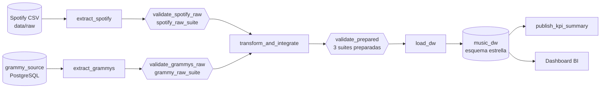

# Arquitectura del pipeline y política de confiabilidad

> Secciones 5, 6.7, 6.9 y 6.11 del enunciado. DAG: `dags/reliable_music_pipeline.py`.

## Flujo

## Tareas

| Tarea | Responsabilidad | Entrada → salida (XCom = solo rutas y metadatos) | Reintentos |
| --- | --- | --- | --- |
| `extract_spotify` | Lee el CSV (parámetro `spotify_file`) sin limpiar y guarda el lote raw | → `{path, rows, columns, source}` | 0 |
| `extract_grammys` | Lee `grammy_source.grammy_awards` desde **PostgreSQL** (no desde el CSV) | → `{path, rows, columns, source}` | 3 (solo transitorias) |
| `validate_spotify_raw` | Compuerta raw: ¿los datos pueden entrar a la transformación? | path → decisión + archivo de resultado GX | 0 |
| `validate_grammys_raw` | Compuerta raw de Grammy | path → decisión + archivo de resultado GX | 0 |
| `transform_and_integrate` | T01–T13: limpieza, armonización, integración por artista y tablas del modelo | 2 paths → paths de 7 tablas + reporte | 0 |
| `validate_prepared` | Compuerta preparada: ¿la transformación produjo datos aptos para cargar? | paths → decisiones por suite | 0 |
| `load_dw` | Truncate-and-load transaccional a `music_dw` | paths → conteos antes/después | 3 (solo transitorias) |
| `publish_kpi_summary` | Consulta las 4 vistas KPI y guarda el resumen del lote | → `data/work/<run_id>/kpi_summary.json` | 3 (solo transitorias) |

**Dependencias:** `transform_and_integrate` espera a que **ambas** compuertas raw terminen con éxito
(`[validate_spotify_raw, validate_grammys_raw] >> transform_and_integrate`), y `load_dw` espera a
`validate_prepared` (`validate_prepared >> load_dw`). Con la regla por defecto de Airflow
(`all_success`), si una compuerta falla, todo lo posterior queda en **`upstream_failed`**.

**Interfaces:** las tareas intercambian rutas y metadatos compactos. Los datos viven en
`data/work/<run_id>/` (raw, prepared, cuarentena, reporte), una carpeta por ejecución, así que
cada lote queda investigable después. El almacén de metadatos de Airflow nunca transporta DataFrames.

## Política de fallas

| Condición | Severidad / tipo | Respuesta del pipeline | ¿Reintento? | Justificación |
| --- | --- | --- | --- | --- |
| Regla Critical raw (DQ01–DQ06, DQ09–DQ11) | Critical · datos | La compuerta falla; transformación, validación preparada y carga quedan `upstream_failed` | No | El mismo lote falla igual: reintentar solo gasta tiempo |
| Regla Warning raw (DQ07, DQ08, DQ12, DQ13) | Warning · datos | Se registra en el log y en el JSON de GX; continúa y la transformación aplica el tratamiento (T03, T05, T09) | No | La política documentada permite continuar |
| Regla Info (DQ22) | Info | Solo se registra | No | Monitoreo de tendencia |
| Regla Critical preparada (DQ14–DQ20) | Critical · invariante | `validate_prepared` falla; `load_dw` no se ejecuta; el DW conserva la última carga buena | No | Indica un defecto de la transformación, no de la infraestructura |
| Archivo de Spotify inexistente | Determinista · contrato | `extract_spotify` falla de inmediato | No | Un archivo faltante no aparece reintentando |
| Base de datos caída, conexión rechazada o cortada | Transitoria · operativa | La tarea se reintenta (30 s, 60 s, 120 s; máximo 3 min entre intentos) | **Sí, 3** | Otro intento puede tener éxito sin cambiar datos ni código |
| Error SQL determinista (tabla inexistente, tipo inválido, llave foránea, conteo no conciliado) | Determinista · datos/esquema | `AirflowFailException`: falla **sin consumir reintentos**; si estaba cargando, `ROLLBACK` | No | Se clasifica con `src/db.is_transient()`: solo `OperationalError`/`InterfaceError` de psycopg2 son transitorios |
| Tarea colgada | Operativa | `execution_timeout` de 20 min por tarea | Según la tarea | Evita ejecuciones que nunca terminan |
| Dos ejecuciones al mismo tiempo | Operativa | `max_active_runs = 1` | — | Dos cargas simultáneas al DW no son seguras |

> **No hay `retries=3` en todas partes.** Las tareas de archivos, validación y transformación tienen
> 0 reintentos porque sus fallas son deterministas. Las 3 tareas que tocan la base de datos se
> reintentan, pero **solo** si la falla es de conexión. Este comportamiento se verificó: un error de
> llave foránea en `load_dw` se marcó como determinista y no se reintentó.

## Logging y observabilidad

| Pregunta | Dónde se responde |
| --- | --- |
| ¿Qué se ejecutó? | DAG Run (`run_id`), Task Instances; cada log de extracción muestra la fuente y la ruta del lote |
| ¿Cuándo? | Tiempos del DAG Run y de cada tarea (Grid view); `validated_at` en cada JSON de GX; `loaded_at` en `etl_load_audit` |
| ¿Tuvo éxito? | Estados del DAG y de las tareas + conteos: filas extraídas, filas validadas, `integration_report.json`, conteos antes/después de la carga |
| ¿Dónde falló? | La primera tarea en `failed`; las siguientes en `upstream_failed` |
| ¿Por qué? | El log de la compuerta lista cada regla con `[OK]`/`[FAIL]`, su `rule_id`, severidad y % de filas inesperadas; el mensaje de error nombra las reglas Critical violadas (ej. `['DQ04']`). Evidencia completa en `gx/validation_results/<run_id>/` |
| ¿Qué pasó después? | Reintento (estado `up_for_retry`), detención (`upstream_failed`) o continuación con Warning (mensaje `La politica documentada permite continuar`) |

## Pruebas obligatorias (sección 7)

| Prueba | Cómo ejecutarla | Resultado esperado (verificado) |
| --- | --- | --- |
| **A — Ejecución exitosa** | *Trigger DAG* con el parámetro por defecto (`spotify_dataset.csv`) | 8 tareas en `success`; Warning DQ13 registrado; DW con 156,739 filas en `fact_track_artist` y 2,771 en `fact_grammy_award` |
| **B — Falla Critical controlada** | `docker compose exec airflow-scheduler python /opt/airflow/src/make_bad_data.py` y luego *Trigger DAG w/ config* con `spotify_file = spotify_bad_popularity.csv` | `extract_spotify` ✅ · `validate_spotify_raw` ❌ por **DQ04** (1 fila con `popularity = 150`) · `transform_and_integrate`, `validate_prepared`, `load_dw`, `publish_kpi_summary` en `upstream_failed` · DW sin cambios |
| **C — Re-ejecución segura** | Ejecutar dos veces la Prueba A y comparar con `sql/rerun_check.sql` | Conteos, sumas de medidas y hash de llaves **idénticos**; `etl_load_audit` registra 2 cargas |

### Estrategia de repetibilidad

**Truncate-and-load transaccional** (`src/load.py`): dentro de una única transacción se crea la
estructura si falta, se truncan hechos y dimensiones, se copian los datos con `COPY`, se verifican los
conteos contra los archivos preparados y se registra la carga en `etl_load_audit`. Luego `COMMIT`.

- **Re-ejecutar con el mismo lote** produce exactamente el mismo contenido. La tabla se reemplaza
  completa y las llaves subrogadas son deterministas, así que las mismas filas reciben las mismas llaves.
- **Si una carga falla a mitad de camino** (o se reintenta), `ROLLBACK` deja el DW **igual que antes**.
  Nunca queda una carga parcial. Verificado forzando una violación de llave foránea en
  `fact_grammy_award` después de truncar y cargar las demás tablas: el DW conservó la carga anterior.
- **Si falla una compuerta**, `load_dw` ni siquiera se ejecuta: el DW conserva la última carga buena.
- `etl_load_audit` no se trunca: es el historial de cargas exitosas.
