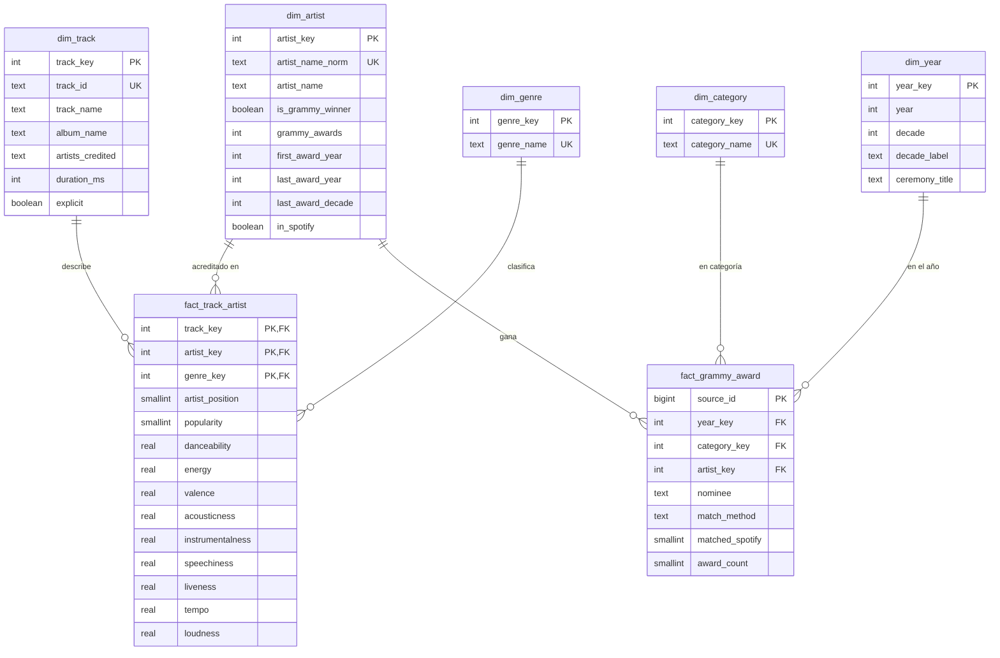

# Modelo dimensional — Data Warehouse `music_dw`

> Secciones 6.4 y 6.10 del enunciado. Definición ejecutable: `sql/dw_schema.sql`
> (la tarea `load_dw` la ejecuta en cada corrida; es idempotente).

## Decisiones de diseño (Kimball, 4 pasos)

| Decisión | Contenido |
| --- | --- |
| **Procesos de negocio** | (1) **Publicación de canciones en Spotify** con su desempeño y perfil sonoro. (2) **Premiación Grammy**: un premio ganado por un artista. Los dos procesos se integran mediante la **dimensión conformada `dim_artist`** (un esquema estrella por proceso que comparte dimensión) |
| **Grano de `fact_track_artist`** | **Una fila por canción de Spotify × artista acreditado × género.** Es el grano atómico de la fuente después de separar los créditos (T06): una canción con 2 artistas en 3 géneros genera 6 filas |
| **Grano de `fact_grammy_award`** | **Una fila por premio Grammy ganado por un artista en una categoría y un año** (1958–2018). Equivale a una fila de la fuente `grammy_awards` (`source_id`) |
| **Dimensiones** | `dim_artist` (conformada), `dim_track`, `dim_genre`, `dim_category`, `dim_year` |
| **Medidas** | `fact_track_artist`: `popularity`, `danceability`, `energy`, `valence`, `acousticness`, `instrumentalness`, `speechiness`, `liveness`, `tempo`, `loudness` (más `key`, `mode`, `time_signature` como atributos técnicos). `fact_grammy_award`: `award_count` (= 1, aditiva) y `matched_spotify` (0/1, para medir cobertura) |
| **Llaves** | Llaves **subrogadas** enteras en todas las dimensiones, generadas de forma determinista (1..n sobre la llave de negocio ordenada). Las llaves de negocio se conservan con restricción `UNIQUE`: `artist_name_norm`, `track_id`, `genre_name`, `category_name`. `dim_year` usa el propio año como llave (natural y estable) |
| **Integridad referencial** | Todas las llaves de los hechos son `NOT NULL` con `FOREIGN KEY` hacia su dimensión. La PK de `fact_track_artist` es el grano (`track_key`, `artist_key`, `genre_key`) |

### Por qué estas decisiones

- **¿Por qué el grano incluye al artista?** R1, R2 y R4 analizan **artistas**. Si el grano fuera solo
  la canción, el crédito se perdería para los artistas secundarios (30,075 filas tienen varios artistas).
- **¿Por qué el grano incluye el género?** R2 agrupa por género, y en la fuente la misma canción
  pertenece a varios géneros (16,299 casos). Las vistas KPI cuentan cada canción una sola vez
  (`DISTINCT`) cuando el análisis no es por género.
- **¿Por qué dos tablas de hechos y no una?** Son procesos distintos con granos distintos. Guardar el
  número de premios en `fact_track_artist` repetiría el mismo premio en cada canción del artista.
  Por eso `dim_artist` resume la condición de ganador (`is_grammy_winner`, `last_award_decade`) para
  filtrar, y `fact_grammy_award` guarda el detalle de cada premio.
- **Medidas derivadas fuera del hecho:** promedios y porcentajes (KPI) se calculan en las vistas, no
  se almacenan en los hechos.

## Diagrama

## Cómo se responde cada requerimiento

| Req. | Tablas | Vista KPI (`sql/dw_schema.sql`) | Lógica |
| --- | --- | --- | --- |
| R1 | `fact_track_artist` + `dim_artist` | `kpi_r1_popularity_by_winner` | Popularidad promedio por artista (cada canción una vez), agrupada por `is_grammy_winner` |
| R2 | `fact_track_artist` + `dim_genre` + `dim_artist` | `kpi_r2_genre_winners` | Artistas distintos por género, % ganadores y suma de `grammy_awards` |
| R3 | `fact_track_artist` + `dim_artist` + `dim_track` | `kpi_r3_audio_profile` | Promedio de características por canción; la canción es "de artista ganador" si alguno de sus artistas ganó |
| R4 | `fact_track_artist` + `dim_artist` | `kpi_r4_popularity_by_decade` | Popularidad de los ganadores agrupada por `last_award_decade` |

El detalle por premio (categoría, año, obra) queda disponible en `fact_grammy_award` para
profundizar en el dashboard (por ejemplo, premios por década o por categoría).

## Volumen cargado (lote entregado)

| Tabla | Filas |
| --- | --- |
| dim_artist | 30,249 |
| dim_track | 89,206 |
| dim_genre | 114 |
| dim_category | 396 |
| dim_year | 61 |
| fact_track_artist | 156,739 |
| fact_grammy_award | 2,771 |
